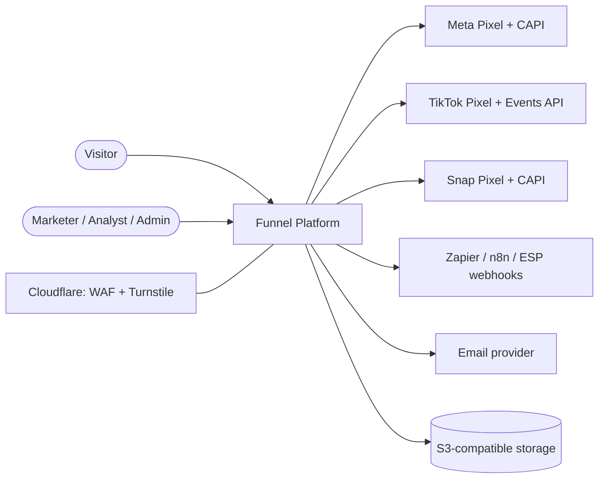
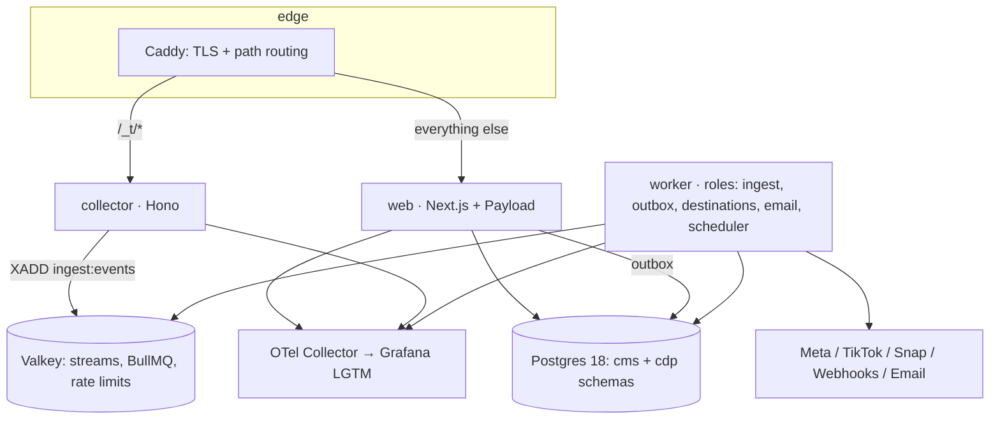

# Architecture overview

The decisions behind this design are recorded in `docs/adr/`. The requirements are in `docs/requirements.md`.

## C4 level 1: System context



## C4 level 2: Containers



## C4 level 3: Modules (`packages/*`)

| Package               | Responsibility                                                                                                                        |
| --------------------- | ------------------------------------------------------------------------------------------------------------------------------------- |
| `platform`            | Shared kernel: env config, logger (PII redaction), errors, request context, crypto, Redis + dedupe publish, OpenTelemetry, SSRF guard |
| `contracts`           | Zod contracts between the CMS and workers: config snapshots, outbox payloads, segment DSL, public API (ADR-0025)                      |
| `event-schemas`       | Event envelope, versioned event registry, upcasters, stream names                                                                     |
| `db`                  | `cdp` SQL migrations, partitions, typed drizzle tables, repositories (incl. the `cms.contacts` read model)                            |
| `modules/attribution` | URL parameter and click-id capture                                                                                                    |
| `modules/consent`     | Region regimes, effective consent, destination gating (LDU), Google Consent Mode                                                      |
| `modules/forms`       | Validator from the published form, spam signals, field mapping, dedupe decision                                                       |
| `modules/tracking`    | Session and funnel-journey aggregation                                                                                                |
| `modules/experiments` | Deterministic weighted assignment, significance, SRM                                                                                  |
| `modules/email`       | Signed links, rendering with RFC 8058 headers, sequence scheduling and decisions                                                      |
| `modules/segments`    | Segment DSL → parameterised SQL                                                                                                       |
| `destinations-sdk`    | `DestinationAdapter` contract, hashing, retry policy, fixtures                                                                        |
| `destinations/*`      | Meta CAPI, TikTok Events API, Snap CAPI, Standard Webhooks                                                                            |
| `email-providers`     | SMTP, Postmark, Resend, SES                                                                                                           |
| `tracker-sdk`         | Browser SDK: events, sessions, touches, consent banner, pixels                                                                        |

## Allowed dependency directions

These are enforced by `.dependency-cruiser.cjs`.

```
apps/*  →  packages/modules/*  →  packages/{event-schemas, db, destinations-sdk}  →  packages/platform
apps/*  ↛  apps/*            packages/*  ↛  apps/*          destinations/*  →  only destinations-sdk, event-schemas, platform
```

## Hot path: event ingestion

1. The SDK sends a batch of events to `POST /_t/e`.
2. The collector validates the batch (Zod), checks rate limits, enriches each event, sets cookies, dedupes and writes it to the stream with `XADD`. It returns 204.
3. The `worker` (ingest role) reads the stream with `XREADGROUP` in batches of up to 500.
4. It upcasts old event versions, resolves identity, groups events into sessions and inserts them with `ON CONFLICT DO NOTHING`.
5. It updates the read models and creates jobs on the destination queues.

## Hot path: sign-up

1. `POST /api/v1/forms/:id/submissions` (web): same-origin check, rate limit, published form
   snapshot, validation, consent for the request region, spam checks.
2. One Payload transaction: contact upsert (dedupe on email then phone), submission with the full
   attribution snapshot, identity link, platform identifiers, consent record and outbox rows
   (`event.server`, `identity.linked`, `email.send`, `sequence.trigger`, `contact.changed`).
3. The browser fires the pixel conversion with the same `event_id`.
4. The relay (worker) publishes the server event to the stream, backfills identity, enqueues email,
   enrolls sequences and re-evaluates segments.
5. Ingest stores the server event and fans out to destinations; the destination workers deliver
   with per-destination rate limits, retries and the delivery log.
